# Paragon Training & Certification Platform

An online training and certification system I built for **Paragon Inspection Solutions**. It replaced a white-labelled TalentLMS site with our own platform. Inspectors learn the Tru-Fit inspection method, sit checkpoint quizzes and a final exam, and receive verifiable certificates. Administrators manage approvals, sign-offs, access to the Tru-fit app and training records.

> This is a showcase of the project. The source code, course material and exam content are kept in a private repository. All names in the screenshots are test data.

**Live site:** https://paragon-training.netlify.app

---

## What it does

**For trainees**
- Sign up and request courses, reading an **About this course** panel for each (introduction, learning objectives and FAQs). Each course is approved separately by an admin, who assigns the trainee to their company and sets the number of attempts allowed.
- Work through each course section by section in a locked-down viewer. Sections can open with an **embedded training video** alongside numbered step-by-step instructions. Course PDFs are drawn onto the page with no download or print option, a watermark shows the trainee's name, and a hover magnifier helps with detailed inspection images.
- Take a photo at the start of each course to confirm identity.
- Answer checkpoint questions to unlock the next section. Attempts are limited and questions are shuffled on every attempt.
- Sit a single-attempt final exam with an 80% pass mark. Exams are marked on the server, so the answers never reach the browser.
- Receive a **Certificate of Training** and a **Certificate of Examination** as PDFs by email. The examination certificate has an expiry date and a renewal window.
- Can't start training until Paragon has placed them in their company, because the company decides which Tru-Fit database their inspection uploads go to.
- Send Paragon a request through **Ask Paragon**: help with a course, a copy of a course, a reasonable adjustment, or a data request.

**For administrators**
- A dashboard listing what needs action:
  - course requests;
  - trainees who are stuck (out of attempts or failed the exam);
  - practical sign-offs;
  - access to grant;
  - emails that failed to send;
  - requests from trainees.
- A **company list** managed by admins. Trainees are placed in a company when their course is approved, and a course can't be approved without one.
- A **Certificates** area: when an inspector changes employer or name, an admin updates all their certificates in one go. Certificate numbers, issue dates and expiry dates are preserved, the PDFs are **re-issued and emailed automatically**, and every change is recorded with who made it, when and why.
- Access rules worked out automatically. Tru-fit app access is only granted once a trainee holds Part 1 and a Part 2. System-admin training (AU01) grants Tru-fit administrator access instead.
- A full student record:
  - progress, and attempts used on each section;
  - every answer given;
  - start photos;
  - certificates, which can be withdrawn with a reason;
  - an **audit log** of every admin action;
  - a history of name and company changes.
- A one-click **PDF training record** for audits.
- Housekeeping for data retention (expired photos, inactive accounts).

**For clients and employers**
- A public **certificate verification page**. Enter the certificate number to see whether it is valid, expired or withdrawn, the holder's company, and when the company was last updated.
- A clear warning, on the verification page and on the certificate itself, that the company shown is the Tru-Fit database the holder's inspections upload to, so a new employer knows to contact Paragon before any data is uploaded.

## Screenshots

| | |
|---|---|
| 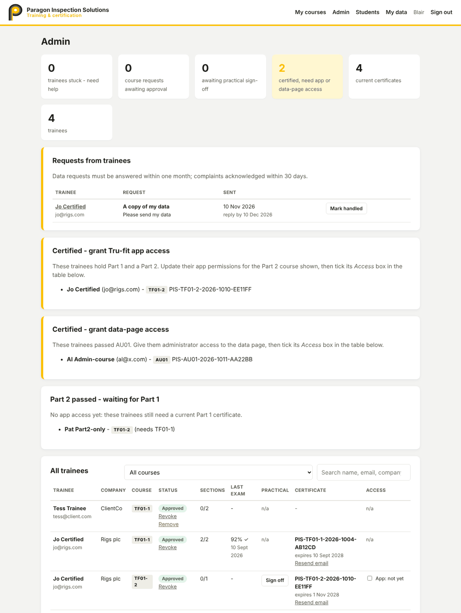 **Admin dashboard**: everything waiting for action | 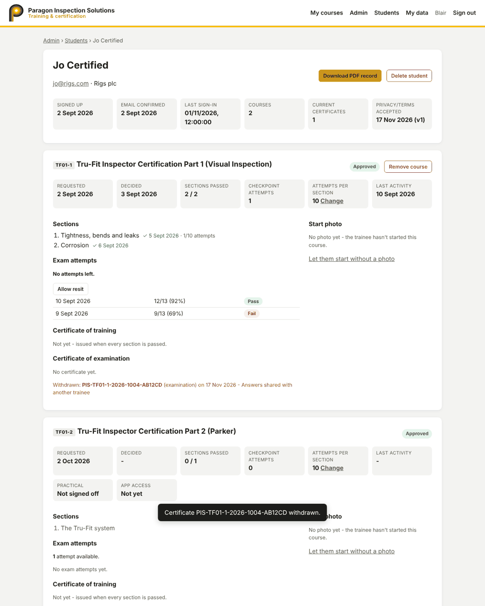 **Student record**: progress, attempts, certificates, audit log |
| 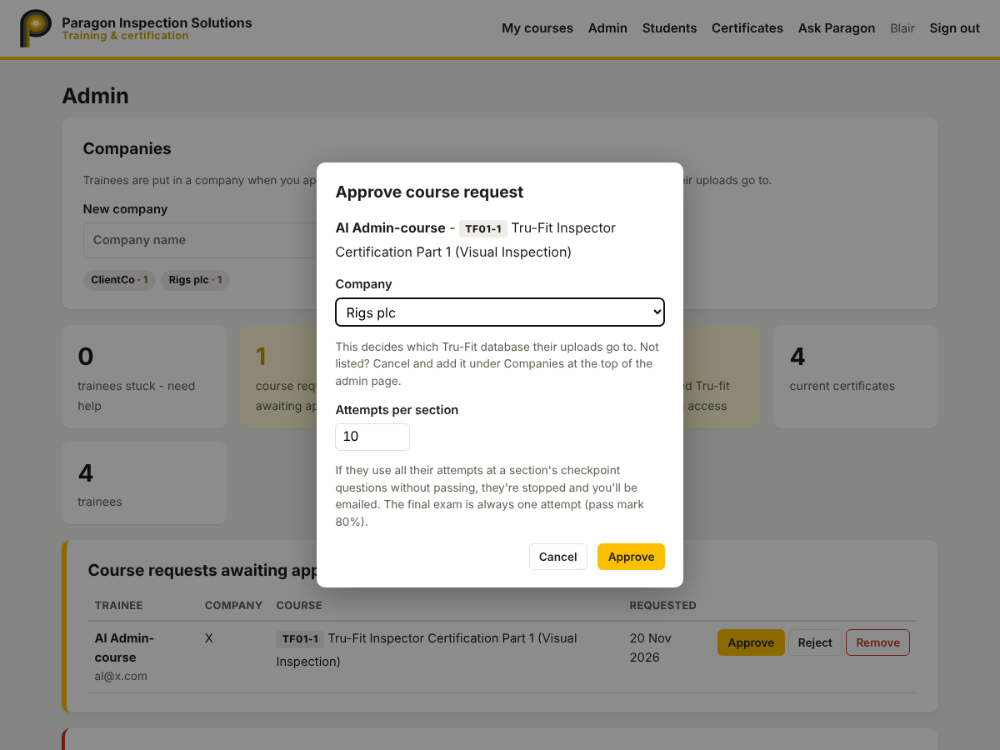 **Approving a course request**: choosing the trainee's company and attempt limits | 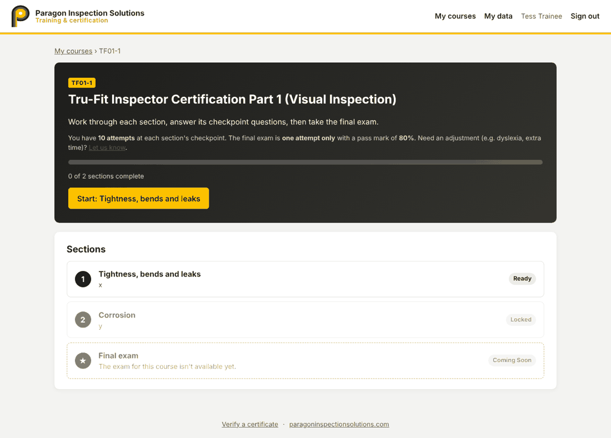 **Trainee course page** |
| 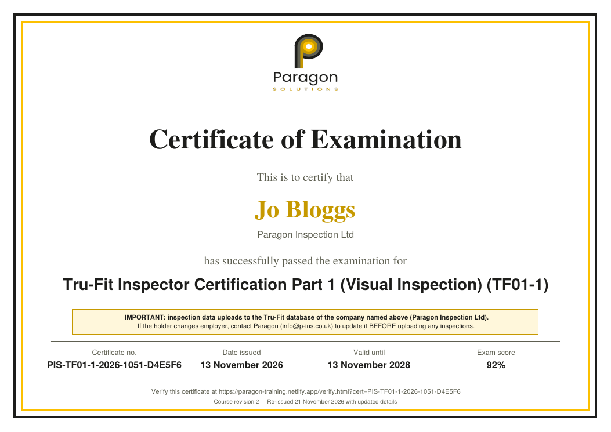 **Generated certificate** (PDF) with the Tru-Fit database notice | 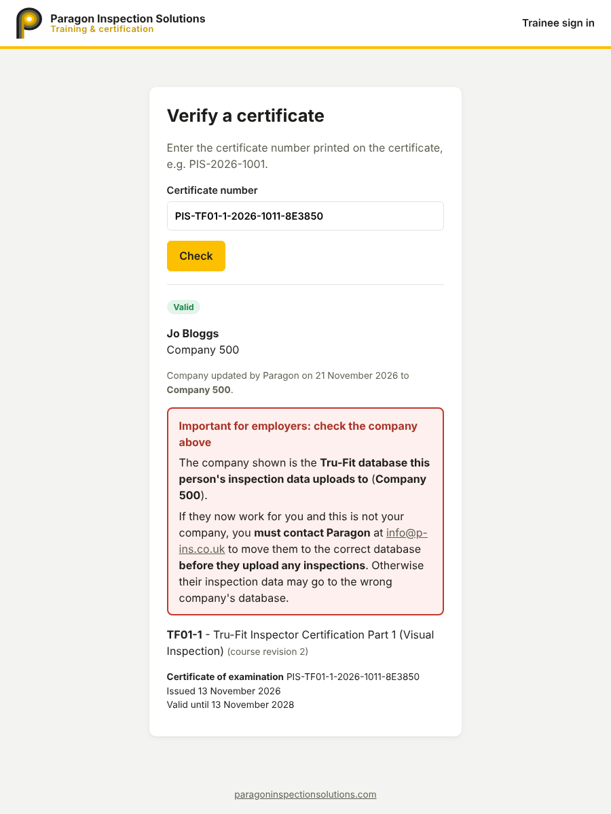 **Public verification** with the employer warning |
| 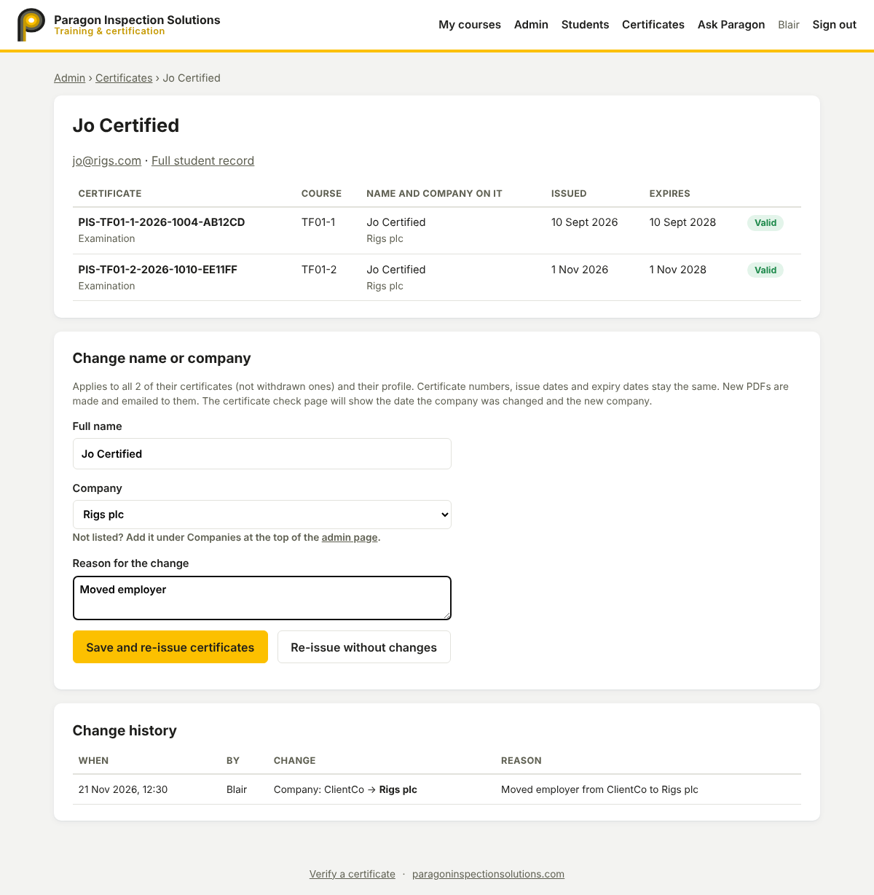 **Certificates area**: change company or name, re-issue, change history | 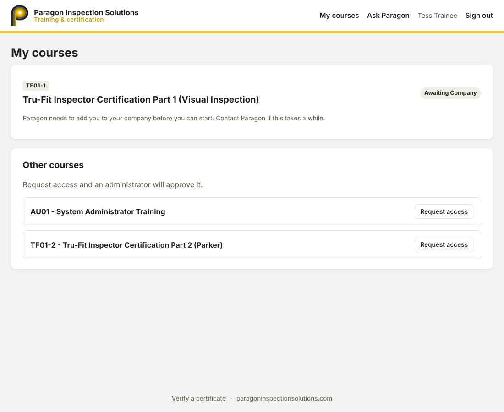 **Course section** with an embedded video and step-by-step instructions |
| 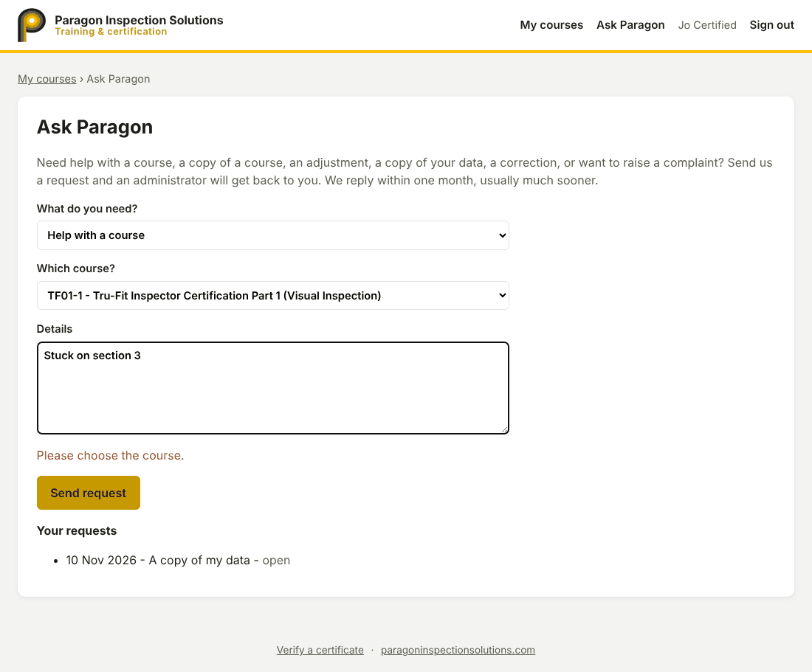 **Ask Paragon**: help, course copies, adjustments and data requests | 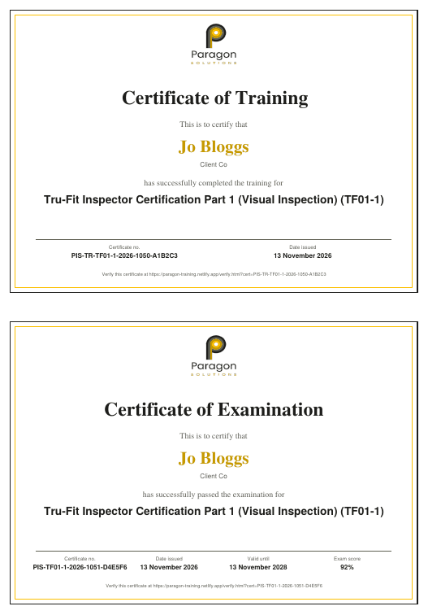 **Certificates of training and examination** |

## How it's built

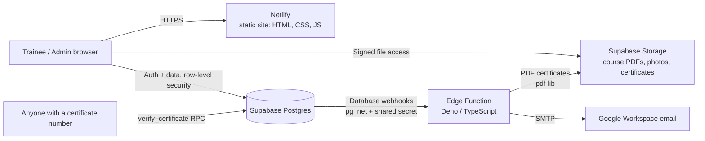

| Layer | Technology |
|---|---|
| Front end | Plain JavaScript single-page app (no framework), PDF.js for the secure viewer (cached in the browser and refreshed when a course file changes), jsPDF for training records, privacy-enhanced YouTube embeds |
| Hosting | Netlify, with a strict Content Security Policy and security headers |
| Database & auth | Supabase (PostgreSQL), email/password auth, row-level security on every table |
| Server logic | PostgreSQL functions (security definer) for marking, attempt limits, certificates and access rules |
| Background jobs | Supabase Edge Function (Deno/TypeScript): certificate PDFs, re-issues, all emails, failure logging |
| Bot protection | Cloudflare Turnstile on sign-up, sign-in and password reset |
| Email | Google Workspace SMTP via nodemailer |

## Security and data protection highlights

- **Server-side marking.** Correct answers are hidden from trainees at database level. Scores, attempt limits and pass marks are enforced in PostgreSQL, not the browser.
- **Row-level security.** Trainees can only ever read their own records. Admin actions go through checked functions.
- **Gated course content.** Course files only open for approved trainees who have completed the identity photo step.
- **Tamper-evident certificates.** Each has a unique number, can be checked publicly, and can be withdrawn. Changes to the name or company on a certificate are logged and shown on the public check.
- **Audit trail.** Every admin action records who did it and when.
- **Privacy by design.** The platform supports:
  - a privacy notice and terms acceptance (versioned);
  - data requests (copy, correction, deletion) with reply-by tracking;
  - retention housekeeping;
  - UK GDPR and Data (Use and Access) Act complaint handling.
- **Hardened emails.** Webhooks are authenticated with a secret held only in the database, and every send or failure is logged and shown to admins.

## Development approach

I designed and built this with the help of AI coding tools, owning the requirements, design decisions, testing and deployment. Features were tested against a local PostgreSQL copy of the schema and automated browser tests (Playwright) before each deployment.

---

© Paragon Inspection Solutions. Shared as a portfolio example; source available on request.
